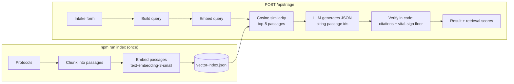

# TriageGuard

**A retrieval-augmented (RAG) triage assistant that checks its own citations.**

You enter a patient's complaint, history and vitals. TriageGuard retrieves the most relevant passages from a small clinical-protocol knowledge base, asks an LLM for a triage level grounded in those passages, and then **verifies the answer in code**: it drops any citation to a passage that wasn't retrieved, and it escalates the result when vital signs cross a critical threshold.

**Live demo:** https://triageguard.onrender.com

> ⚠️ This is a portfolio project. It is not a medical device and must not be used for real clinical decisions. The protocols and test cases were written for this project and have not been clinically validated.

<!-- Add a screenshot or GIF of the app here:  -->

## How it works



1. **Ingestion** (`scripts/build-index.ts`). Each protocol is split into small passages (overview, red flags, vital thresholds, one per urgency level), and each passage is embedded with `openai/text-embedding-3-small` through OpenRouter.
2. **Retrieval** (`server/rag/retriever.ts`). The complaint, history and onset are embedded as a query and compared with every passage by cosine similarity. The top 5 are returned with their scores.
3. **Generation** (`server/triage.ts`). The LLM sees *only* those passages, each tagged with an id, and must return JSON that cites them by id.
4. **Verification** (`server/rag/safety.ts`). Deterministic code, not the LLM:
   - Citations that point to a passage which wasn't retrieved are dropped, and each snippet is replaced with the real passage text, so a citation can't quote words that aren't in the knowledge base.
   - Vitals are checked against the thresholds of the top-ranked protocol. If any is critical and the model chose *Urgent* or *Non-urgent*, the result is raised to *Emergent*, and the UI shows that it was escalated.

## Evaluation

`npm run eval` runs the full pipeline on 16 synthetic cases (`eval/cases.json`) and writes `eval/results.json`, which the **Eval** tab displays.

| Metric | What it measures | Result |
|---|---|---|
| Retrieval hit@1 | Correct protocol ranked first | **93.8%** (15/16) |
| Retrieval hit@5 | Correct protocol in the top 5 | **100%** (16/16) |
| Triage accuracy | Predicted label = expected label | **100%** (16/16) |
| Under-triage rate | Predicted *less* urgent than expected (the most dangerous error) | **0%** |
| Cited rate | At least one citation survived verification | **93.8%** (15/16) |

_Run on 2026-10-22 with `openai/text-embedding-3-small` + `openai/gpt-oss-120b`. Sixteen cases is a small sample, so treat these numbers as a smoke test rather than proof._

**What the eval caught.** The first run had a **19% failure rate**: in 3 of 16 cases the model returned JSON with missing fields, because the request only asked for "a JSON object". The fix was to send a strict JSON Schema (structured outputs), route only to providers that enforce it, and retry once if the output is still invalid. After that, there were 0 failures. In one case (`st-4`) the model cited a passage id that had not been retrieved. The citation check dropped it, and the UI marks that result for review.

## Tech stack

- **Frontend:** React 19, TypeScript, Vite, Tailwind CSS
- **Backend:** Node.js, Express, Zod for request and response validation
- **AI:** OpenRouter for both embeddings (`openai/text-embedding-3-small`) and generation (`openai/gpt-oss-120b`). Gemini is supported as an optional fallback.
- **Vector search:** in-memory cosine similarity over a JSON index. The corpus is small, so a vector database would add infrastructure without adding value.
- **Quality:** Vitest unit tests; GitHub Actions runs type-check, tests and build on every push

## Run it locally

Prerequisites: Node.js 20+ and an [OpenRouter API key](https://openrouter.ai/keys).

```bash
npm install
cp .env.example .env.local     # then add your OPENROUTER_API_KEY
npm run index                  # embed the knowledge base -> data/vector-index.json
npm run dev                    # http://localhost:3000
```

Other commands:

```bash
npm test          # unit tests
npm run eval      # evaluation (add -- --retrieval-only to skip LLM calls)
npm run lint      # type-check
npm run build && npm start
```

## Project structure

```
server.ts                 Express app and API routes
server/
  triage.ts               RAG pipeline: retrieve -> generate -> verify
  llm.ts                  OpenRouter / Gemini client with fallback
  rag/
    chunk.ts              Protocol -> passages
    embed.ts              Embedding clients (OpenRouter, Gemini), batched
    retriever.ts          Index loading and top-k retrieval
    vector.ts             Cosine similarity and ranking
    safety.ts             Citation verification and vital-sign floor
    rag.test.ts           Unit tests
scripts/
  build-index.ts          Ingestion
  eval.ts                 Evaluation
eval/cases.json           Synthetic test cases
src/                      React frontend
```

## Design decisions

- **One key to run it.** OpenRouter serves both the embedding model and the LLM. The index records which embedding model built it, and the server refuses to answer if the query model doesn't match, since vectors from different models can't be compared.

- **The LLM is never trusted to verify itself.** Earlier versions asked the model to fill in a "safety verification" field. Now, checks that can be done in code are done in code.
- **Same pipeline for the API and the eval.** `runTriage()` has no dependency on Express, so the eval script measures exactly what users get.
- **API keys stay on the server.** The browser only talks to `/api/*`.

## Limitations and next steps

- The knowledge base is four hand-written demo protocols. Next step: ingest real public guidelines (PDF -> text -> chunks) and move to pgvector once the corpus grows.
- The test set is small and synthetic. A real evaluation would need cases labelled by clinicians.
- A request takes around 15–30 seconds, mostly LLM time. Streaming the response or using a faster model would improve the experience.
- There is no out-of-scope detection yet. A complaint that matches none of the four protocols still gets their closest passages, so a minimum-similarity threshold should flag it.
- Add hybrid search (BM25 + vectors) and a re-ranker, and compare them using the eval.

## License

MIT
